# AJ Lending: an AI credit-risk and underwriting copilot on AWS

_Project showcase: deck, demo video and write-up._

> A credit score alone doesn't tell you *why*, or *what to do about it*. AJ Lending predicts the chance an applicant repays, explains the decision in plain words, shows a realistic path to approval, and drafts a policy-grounded letter that a person reviews. It was built end to end on AWS, from raw data to a deployed web app.
>
> **It is built for two kinds of users, applicants and staff, and the app looks and works differently for each.**
>
> **It uses agentic AI in both experiences:** assistants that choose tools, look things up and prepare tasks such as applying for a loan or applying a rule to a batch of applicants, and a person confirms every change.

AJ Lending is **one app that serves two kinds of people, and it works differently for each**.

- **Applicants (clients)** sign in to a personal view: their credit score, their existing loans, what is holding the score back, and a way to apply for new loans or ask an AI assistant questions about their own file.
- **Staff** sign in to a separate workspace: the list of applicants, a portfolio view, a detailed review of each person with their risk and the reasons behind it, bulk uploads, letters to approve, and an AI agent that can answer questions across many applicants.

The person's login decides which experience they see.

**Portfolio deck:** [View the slides (PDF)](docs/AJ_Lending_Portfolio.pdf) · [Download the PowerPoint](docs/AJ_Lending_Portfolio.pptx)

**How the numbers are calculated:** [`docs/FORMULAS.md`](docs/FORMULAS.md) (credit score, probability of default, payments, fairness and drift formulas)

**Source code:** private repository, available to share on request.

AJ Lending is a fictional lender. This is a learning and portfolio project, not a real lending product and not legal advice.

## Screenshots

**Applicant view:** credit score, next best steps, existing loans, what is holding the score back, and a late-payment slider.

### More of the applicant experience

| Apply for a loan | Loan explorer |
|---|---|
| 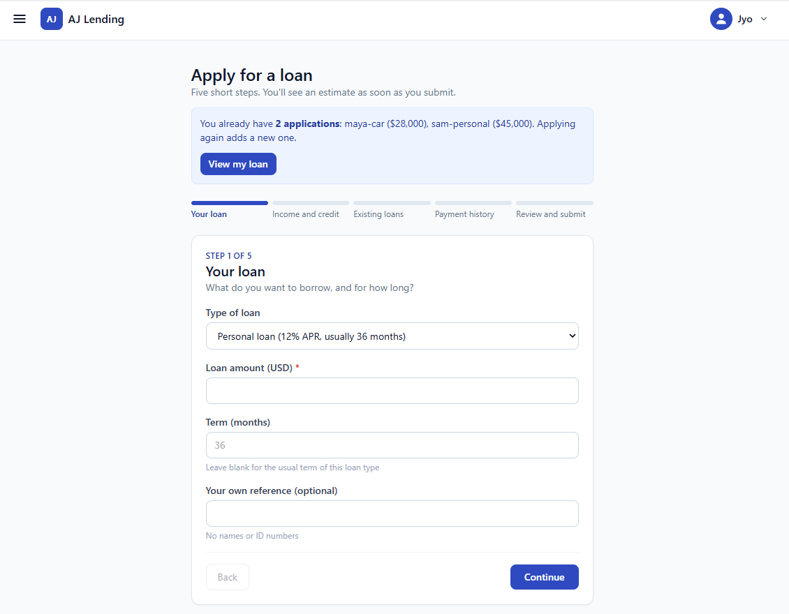 | 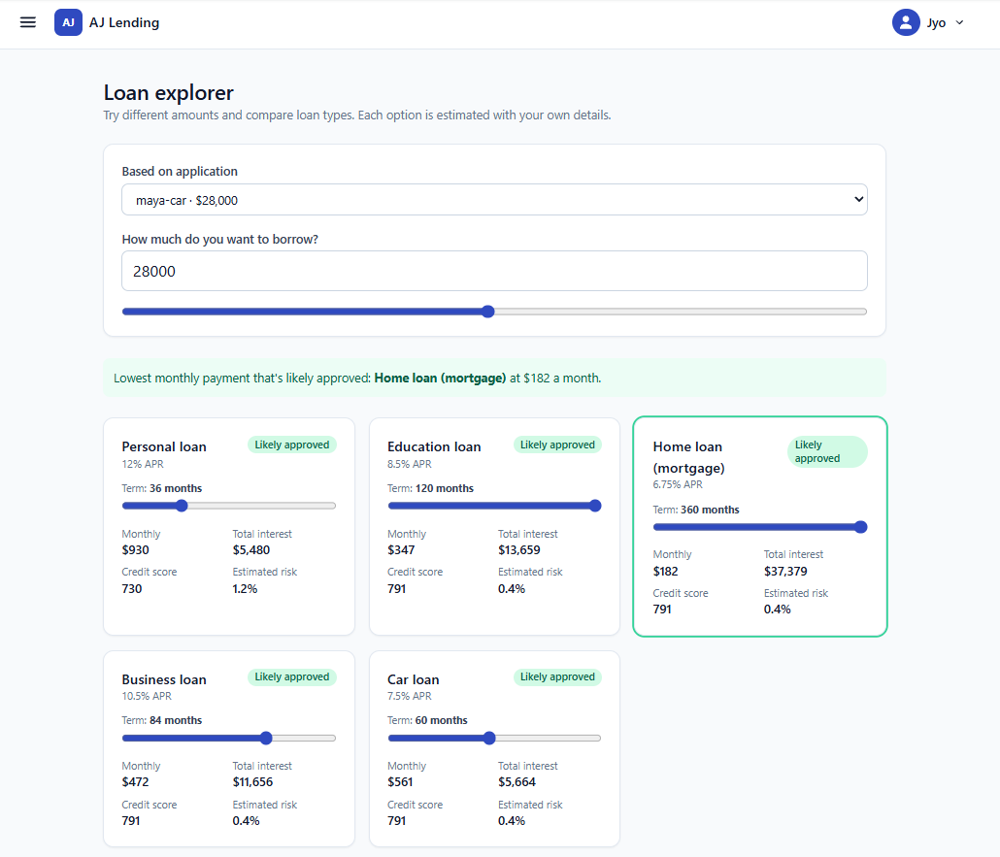 |
| **Five short steps, with the loan type setting the rate.** | **Compare loan types and amounts side by side, each scored on the applicant's own details.** |

| Chat with AI | Menu |
|---|---|
| 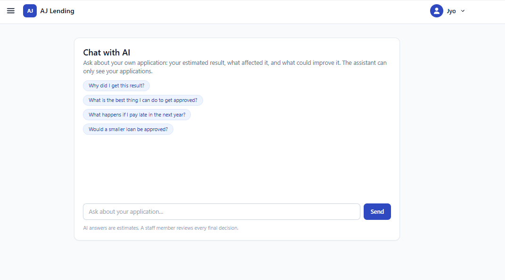 | 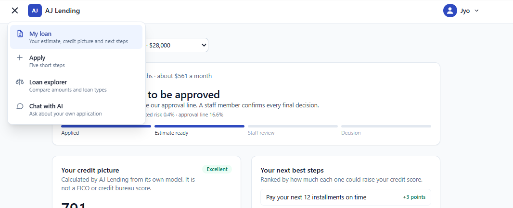 |
| **An assistant that can only see the applicant's own applications.** | **Applicants get four simple screens.** |

| Account menu | Profile |
|---|---|
| 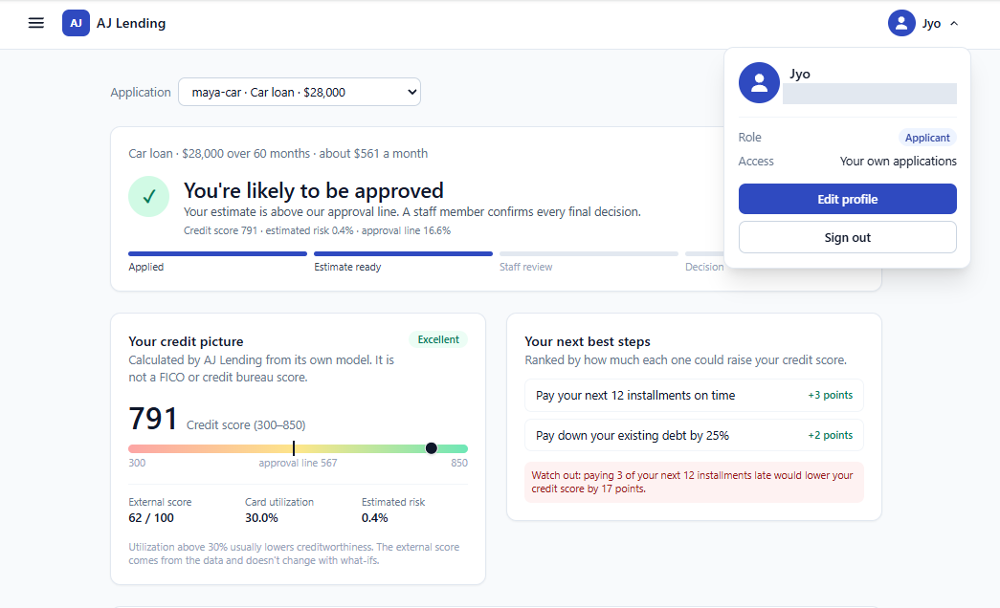 | 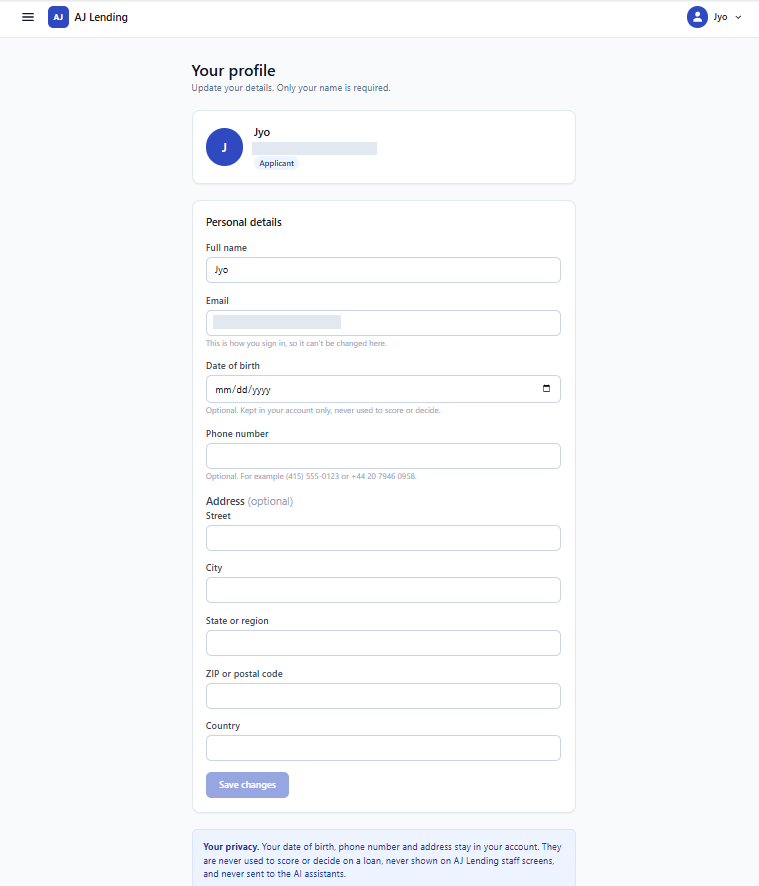 |
| **Role and access shown clearly.** | **Personal details stay in the account and never reach scoring, staff screens or the AI.** |

### The staff experience

Staff and admins sign in to a different app, marked **Admin console**, with a dark header and a separate menu.

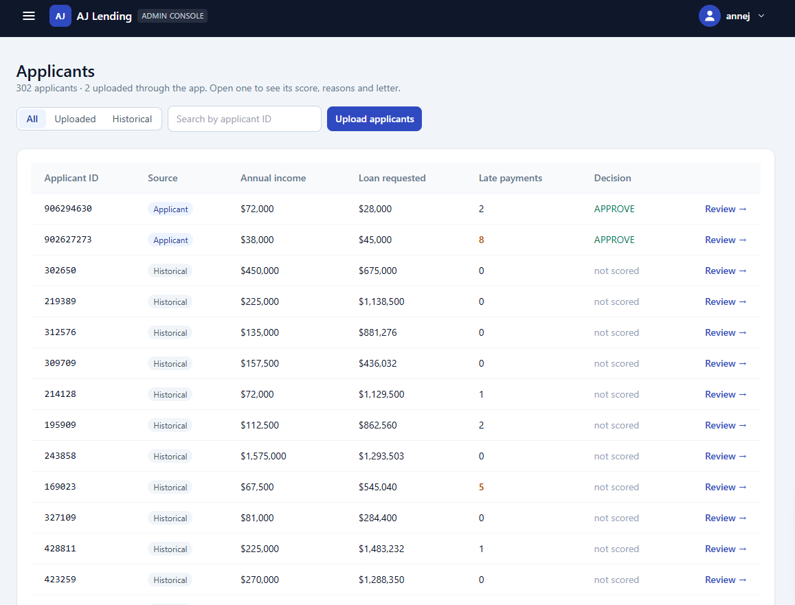
**The applicant list:** 302 applicants, filterable by source, with each person's decision and a link to the detailed review.

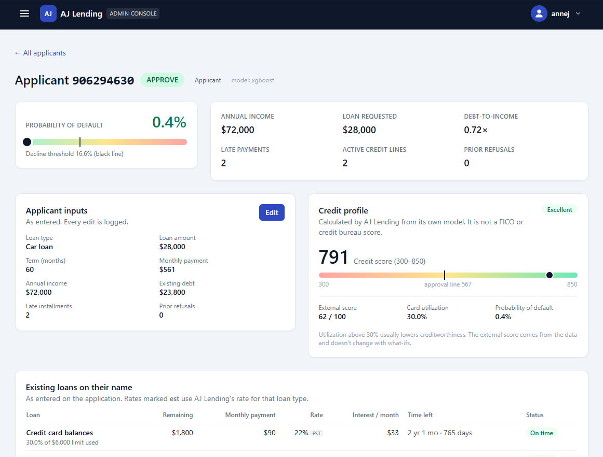
**Detailed review:** probability of default, the credit score, the inputs (every edit is logged) and the applicant's existing loans.

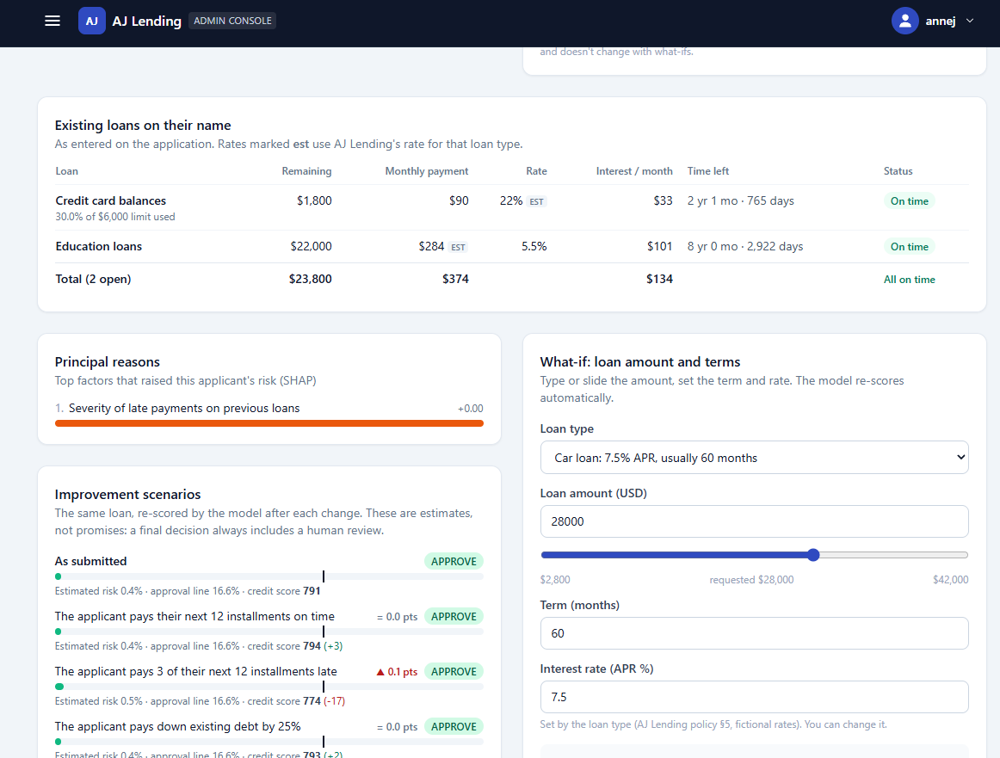
**Why and what-if:** the main reasons from SHAP, improvement scenarios re-scored by the model, and a what-if calculator for loan amount, term and rate.

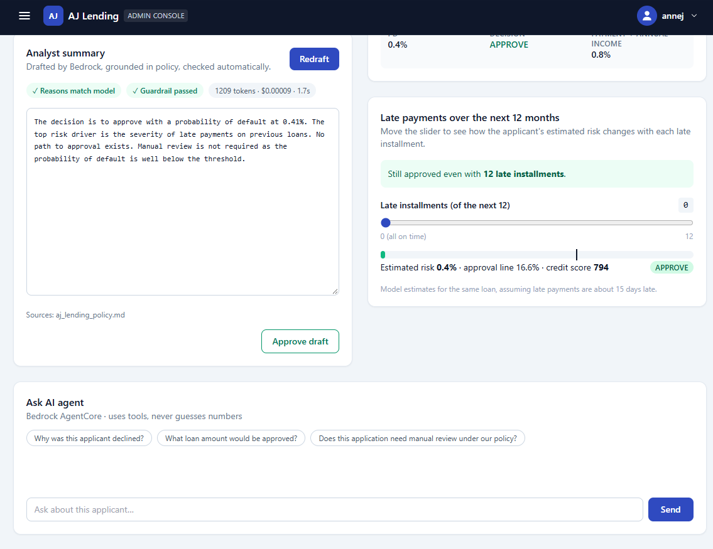
**AI analyst summary:** drafted by Bedrock from the lending policy, with automatic checks (reasons match the model, guardrail passed) and token cost, then approved by a person. Below it, the Ask AI agent.

| Menu | Upload applicants |
|---|---|
| 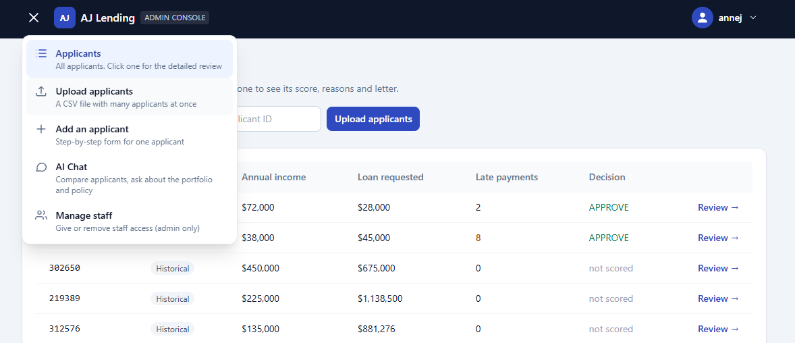 | 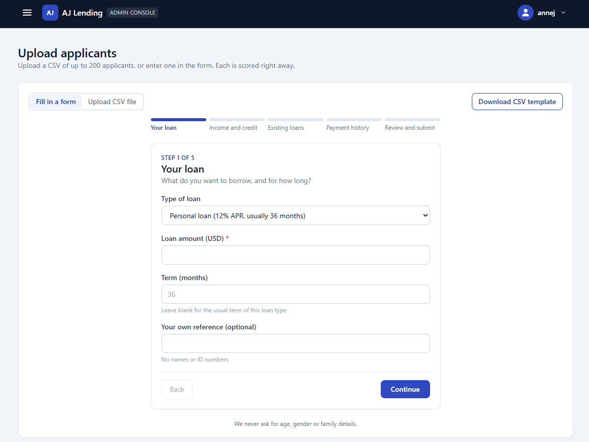 |
| **Applicants, upload, add one, AI chat and staff management.** | **Upload a CSV of up to 200 applicants, or fill in a form. Each is scored right away.** |

| Add an applicant | AI chat across the portfolio |
|---|---|
| 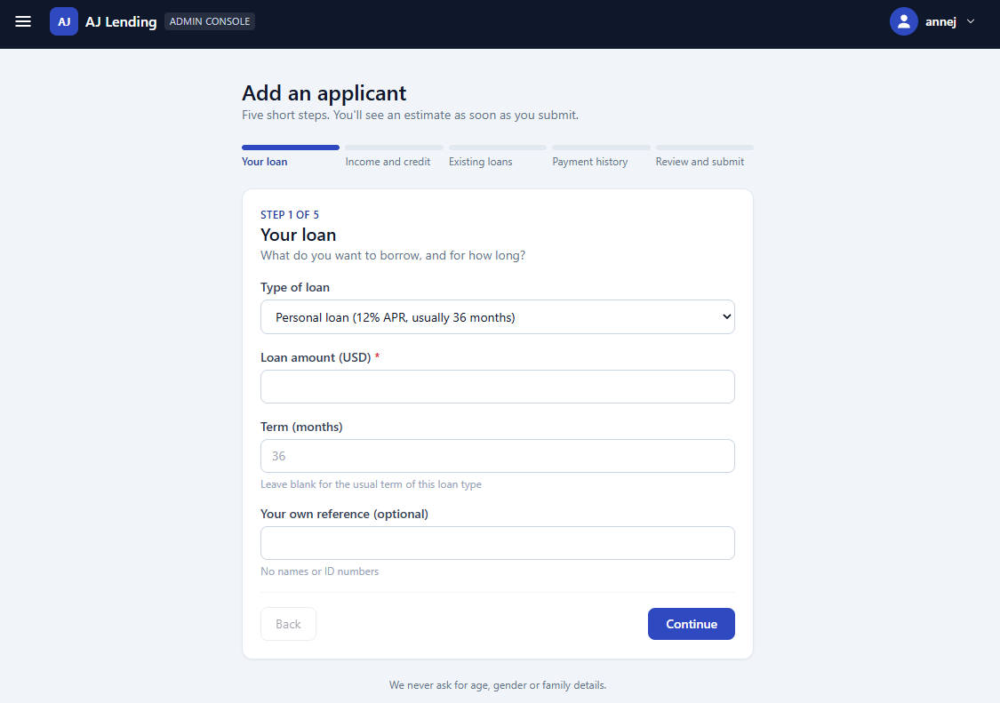 | 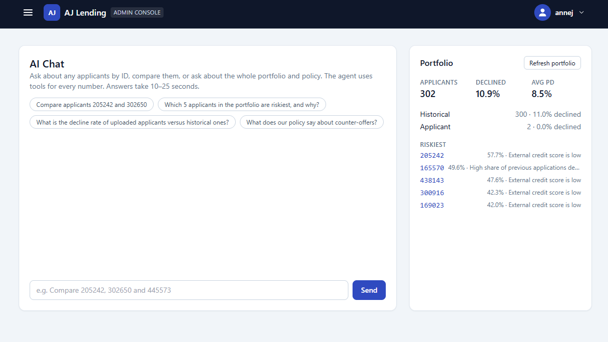 |
| **The same five-step form that applicants use.** | **The agent compares applicants and answers portfolio and policy questions, next to live portfolio numbers.** |

| Manage staff (admin only) | Account menu |
|---|---|
| 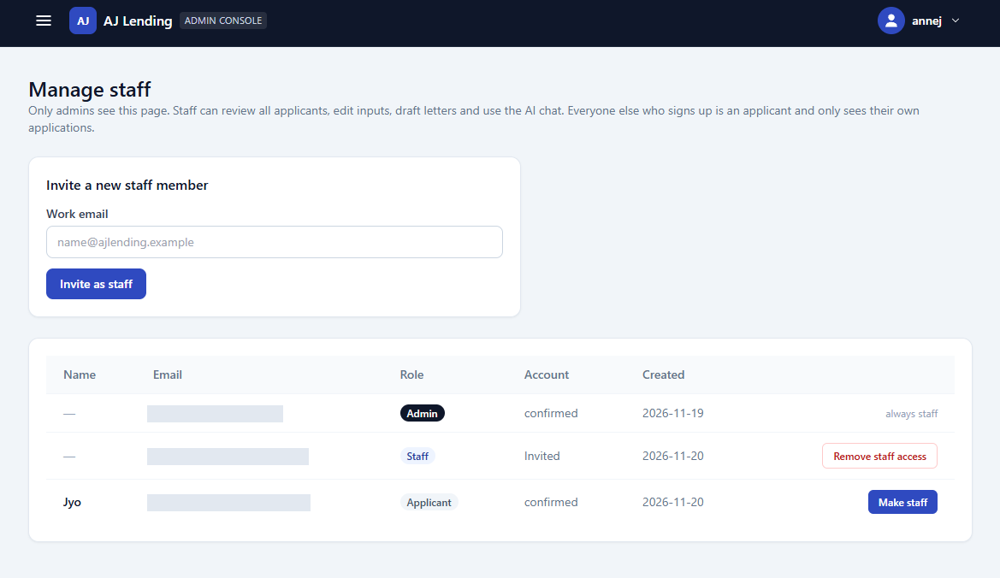 | 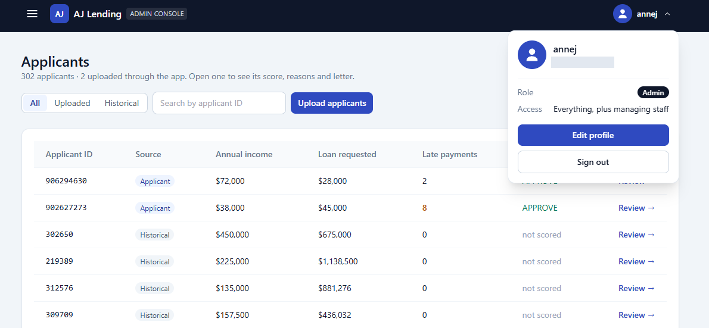 |
| **Admins invite staff and give or remove access. Everyone else is an applicant.** | **The role and what it can access are always visible.** |

---

## One app, two experiences

| Staff (underwriters, admins) | Applicants |
|---|---|
| Applicant list and portfolio view | "My loan": credit score (300 to 850), what is holding it back |
| Detailed review: score, probability of default (PD), top reasons (SHAP), existing loans | Existing loans with rate, remaining balance and remaining time |
| Improvement scenarios and what-if explorer | Late-payment slider to see the effect of paying on time |
| Bulk or single upload of applicants | Apply wizard for different loan types, each with its own rate |
| AI chat across applicants (the staff agent) | Plain-language AI chat about their own file |
| Draft adverse-action and analyst letters, human approval | Profile page: name, date of birth, phone, address, password |

Sign-in is by email through Cognito; a person's group (admin, staff or applicant) decides which screens they see. Personal details such as date of birth, phone and address are kept in the user's profile and are never sent to the scoring API, to staff views or to the AI.

## Agentic AI: assistants that do tasks, with a person in control

AJ Lending uses **agentic AI** in both experiences. An agent is more than a chatbot: it decides which tools to use and in what order, calls them, and builds its answer from what they return. Both agents can also **do tasks**, not only answer questions.

| | Staff agent | Applicant agent |
|---|---|---|
| Built with | Strands Agents on Amazon Bedrock AgentCore | Amazon Bedrock Nova Pro tool use, inside the API |
| Tools | 17 | 9 |
| Can reach | Every applicant | Only that person's own applications |
| Example task | "For the first 5 applicants, reject anyone with 3 or more late payments" | "Would a $20,000 car loan be approved for me? If it looks good, set it up" |

**What the agents can do**
- **Look up:** applicants, comparisons, the portfolio, the lending policy and reminders.
- **Calculate:** what-ifs, how likely different loan options are to be approved, what extra payments would save, and AI letters (which are checked and then approved by a person).
- **Propose a change, which a person confirms:** a new loan application, an edit to an application, a reminder, a new applicant, a batch of staff decisions (reject, approve or send for review), and, for admins only, inviting staff or changing staff access.

**How a task runs**
1. You ask in plain words.
2. The agent plans, calls the tools it needs (for example it reads the first 5 applicants and checks each against the rule), and prepares **one proposal**.
3. A card appears with a plain summary written by code, not by the AI, for example *"Record 1 staff decision(s): Reject 902627273 (3 or more late payments)"*.
4. Nothing happens until the signed-in person presses **Confirm**. Cancelling changes nothing, and a proposal expires after 30 minutes.
5. After confirming, the change is recorded and logged. For decisions, the staff list shows it and the applicant sees it on their own page.

**Safety built in**
- **An agent can only propose.** Wrong guesses cost nothing because nothing runs without the person's Confirm.
- **Tools act as the signed-in user.** The AI never sets who is asking, so an applicant's agent cannot read anyone else's file and a non-admin's agent cannot do admin tasks. Tests prove both.
- **No real payments.** Nothing connects to a bank. If asked to pay a bill, the agent says so, then offers a payoff estimate and a reminder.
- **Protected data stays out.** Age, gender and other protected characteristics are never used in rules or decisions, and profile details such as date of birth, phone and address are never given to the AI.
- **Guardrails and audit.** Bedrock Guardrails check the AI's text, and every proposal and confirmation is written to the audit log.

## Architecture

Five CDK stacks (Data, ML, GenAI, API, Monitoring) deploy everything in `us-east-2`.

## What it demonstrates

**Data engineering.** Home Credit data (307,511 applicants, several related tables) lands in an encrypted S3 lake. A Glue PySpark job builds one profile per applicant, with Athena for SQL exploration and SageMaker Feature Store for serving.

**Machine learning.** XGBoost trained on SageMaker with monotonic constraints, so more late payments can never *raise* a score. Deployed model (version 6): AUC 0.741, Gini 0.481, KS 0.364. The raw probability is turned into a 300 to 850 score using standard scorecard scaling. Every model version waits for a person to approve or reject it in the registry; versions 4 and 5 were rejected.

**Fairness.** An early model leaned on age-related signals. Default rates differed by age band and the four-fifths ratios failed (0.632 at worst). After removing age proxies and testing eight fixes, the ratios came out at 0.825 and 0.965. Protected attributes are used only to measure fairness, never to score.

**Generative AI.** Letters are written by Bedrock Nova and grounded in a lending-policy knowledge base (RAG on S3 Vectors). Bedrock Guardrails filter the output, and automatic checks confirm each letter cites exactly the model's real reasons and no protected terms. A person approves every letter.

**Agentic AI.** Both people get an AI agent that chats and does tasks, using tools that call the same Lambda API as the web app, so scoring logic lives in one place. The staff agent (Strands on Bedrock AgentCore) has 17 tools; the applicant agent (Bedrock Nova Pro tool use) has 9 and can only reach that applicant's own files. An agent can only *propose* a change; the person must press Confirm.

**Security and privacy.** Least-privilege IAM roles, KMS encryption, Cognito groups, an API authorizer, PII kept out of the API, staff views and AI prompts (a test enforces it), and an AWS Budget with email alerts.

**MLOps and LLMOps.** A model registry with approval, in-place endpoint updates with a rollback configuration, a PSI drift Lambda with CloudWatch alarms, per-letter token and cost metrics, and offline letter evaluation.

## Skills demonstrated

### Agentic AI
- **Built a tool-using agent** with the Strands Agents framework, running on Amazon Bedrock AgentCore Runtime (containerized, built with CodeBuild) and powered by Amazon Nova Pro at low temperature for steady answers.
- **Tools that look things up, calculate, and propose:** look-ups (`get_applicant`, `list_applicants`, `compare_applicants`, `portfolio_overview`, `lookup_policy`, `list_reminders`), calculators (`what_if`, `try_loan`, `payoff_plan`, `draft_letter`) and change proposals (`propose_application`, `propose_add_applicant`, `propose_decisions`, `propose_edit`, `propose_reminder`, and, for admins only, `propose_invite_staff` and `propose_staff_access`). The agent decides which to call, and in which order, to answer questions such as "compare these two applicants" or "for the first 5 applicants, reject anyone with 3 or more late payments" (it reads the list, checks the rule, and proposes one batch for a person to confirm).
- **Confirm before change:** a proposal is stored and described by code (not by the AI) and only runs when the signed-in person presses Confirm. Every tool acts as that person, so an applicant's agent cannot reach anyone else's file, and a staff member's agent cannot do admin tasks. Bill payments are not possible: the agent can only calculate what extra payments would do and set a reminder.
- **One backend for people and agent:** every tool calls the same Lambda API the web app uses, so scoring, permissions and fairness rules exist in one place and the agent cannot see more than the app would.
- **Guardrails around the AI:** Bedrock Guardrails on outputs, a retrieval step over a policy knowledge base (RAG on S3 Vectors), automatic checks that a letter cites exactly the model's real reasons and no protected terms, and a person approving every letter.
- **Agent operations:** invoking the deployed agent from scripts, per-request cost and latency tracking, and an offline evaluation of 25 generated letters.

### Data engineering
- Designed an encrypted S3 data lake and a **PySpark job on AWS Glue** that combines several related tables (applications, bureau history, installment payments, previous applications) into one profile per applicant, 307,511 in all.
- Registered the data in **Athena** for SQL exploration and loaded profiles into **SageMaker Feature Store** for serving.
- Kept training and serving features identical with shared derived-ratio code and a **parity test**, avoiding training/serving skew.
- Handled messy real data: missing values, bureau records without interest rates (estimated and flagged as estimates), and a reproducible train/validation/test split.

### Machine learning
- Trained **XGBoost** on SageMaker with **monotonic constraints**, so the model's behaviour matches what a credit reviewer would sign off on.
- Evaluated with **AUC, Gini and KS** (0.741, 0.481, 0.364 for the deployed version) and compared against a logistic-regression baseline.
- Turned probabilities into a **300 to 850 credit score** using standard scorecard scaling, and chose an explicit decision threshold as a policy choice.
- Explained every decision with **SHAP reason codes** and built a "path to approval" counterfactual (the smallest loan reduction that flips a decline).
- Tested **fairness** with Fairlearn and the four-fifths rule, found age bias, removed age proxies and measured the fix (0.632 to 0.825 and 0.965).
- Ran **MLOps**: model registry with human approval, in-place endpoint updates with rollback, PSI drift monitoring with alarms, and 76 automated tests.

All formulas are written out in [`docs/FORMULAS.md`](docs/FORMULAS.md).

## Tech stack

| Area | Tools |
|---|---|
| ML | Python, XGBoost, SHAP, scikit-learn, Fairlearn |
| AWS data and ML | S3, Glue (PySpark), Athena, SageMaker (training, Feature Store, Registry, serverless endpoint) |
| AWS GenAI | Bedrock (Nova Lite and Pro, Titan embeddings, Guardrails, Knowledge Bases), S3 Vectors, AgentCore, Strands Agents |
| Backend | Lambda, API Gateway, Cognito, DynamoDB, CloudWatch, Budgets, KMS |
| Infrastructure | AWS CDK (Python), CodeBuild |
| Frontend | Next.js 15, React 19, TypeScript, Tailwind CSS, Amplify Auth |
| Quality | pytest (76 tests, no AWS needed), GitHub Actions |

## Problems solved along the way

- **Age bias:** found it from the data, removed the proxies, and measured the result with the four-fifths rule.
- **Drift false alarm:** a drift alarm fired on the first run; I traced it to how the baseline was built and corrected it.
- **Serverless endpoint and dependency conflicts:** pinned the container versions so training and inference agree.
- **Private IDs in a public repo:** moved deployment-specific values into a git-ignored `infra/cdk.context.json` and verified the synthesized stack was identical.
- **29-second API limit:** kept the web path fast (a light mode for lists) and moved heavier work to the agent.

## Cost

With nothing running, the stack costs roughly $1 a month, mostly KMS keys. The serverless endpoint is free when idle, and Bedrock is pay per use. An AWS Budget emails you at 80% of a monthly cap. A single command tears everything down.

## How it was built

I built this with an AI coding assistant.

---

© 2026 Jyothsna Anne. All rights reserved, see [LICENSE](LICENSE). The Home Credit dataset belongs to its owners (Kaggle competition terms) and is not included.
