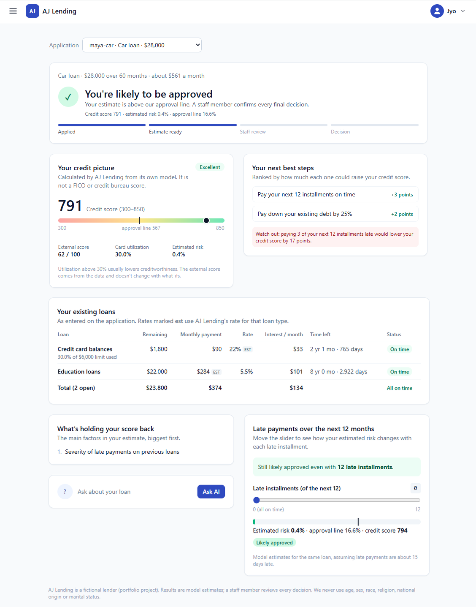
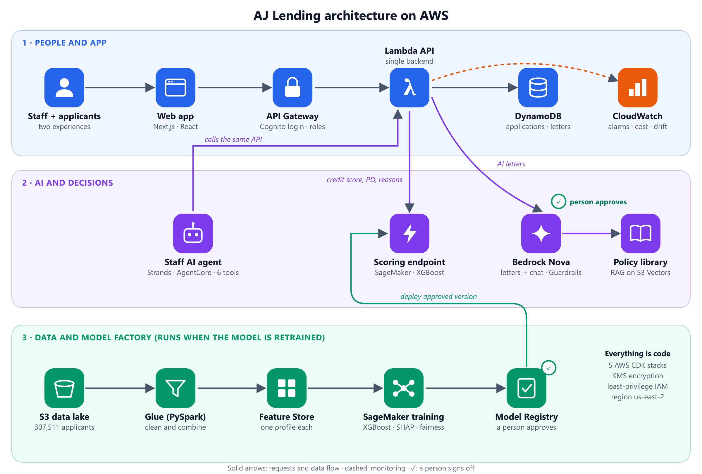

# AJ Lending: an AI credit-risk and underwriting copilot on AWS

_Project showcase: deck, demo video and write-up._

> A credit score alone doesn't tell you *why*, or *what to do about it*. AJ Lending predicts the chance an applicant repays, explains the decision in plain words, shows a realistic path to approval, and drafts a policy-grounded letter that a person reviews. It was built end to end on AWS, from raw data to a deployed web app.

**Portfolio deck:** [`docs/AJ_Lending_Portfolio.pptx`](docs/AJ_Lending_Portfolio.pptx) (18 slides, with speaker notes)
**Demo video:** _drag your screen recording into this README on github.com, and it will play right here_
**Source code:** private repository. I'm happy to walk through it or share access on request.

AJ Lending is a fictional lender. This is a learning and portfolio project, not a real lending product and not legal advice.

<!-- Screenshots: add the images listed in docs/screenshots/README.md, then uncomment

-->

---

## One app, two experiences

| Staff (underwriters, admins) | Applicants |
|---|---|
| Applicant list and portfolio view | "My loan": credit score (300 to 850), what is holding it back |
| Detailed review: score, probability of default (PD), top reasons (SHAP), existing loans | Existing loans with rate, remaining balance and remaining time |
| Improvement scenarios and what-if explorer | Late-payment slider to see the effect of paying on time |
| Bulk or single upload of applicants | Apply wizard for different loan types, each with its own rate |
| AI chat across applicants (the staff agent) | Plain-language AI chat about their own file |
| Draft adverse-action and analyst letters, human approval | Profile page: name, date of birth, phone, address, password |

Sign-in is by email through Cognito; a person's group (admin, staff or applicant) decides which screens they see. Personal details such as date of birth, phone and address are kept in the user's profile and are never sent to the scoring API, to staff views or to the AI.

## Architecture

Five CDK stacks (Data, ML, GenAI, API, Monitoring) deploy everything in `us-east-2`.

## What it demonstrates

**Data engineering.** Home Credit data (307,511 applicants, several related tables) lands in an encrypted S3 lake. A Glue PySpark job builds one profile per applicant, with Athena for SQL exploration and SageMaker Feature Store for serving.

**Machine learning.** XGBoost trained on SageMaker with monotonic constraints, so more late payments can never *raise* a score. Deployed model (version 6): AUC 0.741, Gini 0.481, KS 0.364. The raw probability is turned into a 300 to 850 score using standard scorecard scaling. Every model version waits for a person to approve or reject it in the registry; versions 4 and 5 were rejected.

**Fairness.** An early model leaned on age-related signals. Default rates differed by age band and the four-fifths ratios failed (0.632 at worst). After removing age proxies and testing eight fixes, the ratios came out at 0.825 and 0.965. Protected attributes are used only to measure fairness, never to score.

**Generative AI.** Letters are written by Bedrock Nova and grounded in a lending-policy knowledge base (RAG on S3 Vectors). Bedrock Guardrails filter the output, and automatic checks confirm each letter cites exactly the model's real reasons and no protected terms. A person approves every letter.

**Agentic AI.** A Strands agent running on Bedrock AgentCore has six tools that call the same Lambda API as the web app, so scoring logic lives in one place.

**Security and privacy.** Least-privilege IAM roles, KMS encryption, Cognito groups, an API authorizer, PII kept out of the API, staff views and AI prompts (a test enforces it), and an AWS Budget with email alerts.

**MLOps and LLMOps.** A model registry with approval, in-place endpoint updates with a rollback configuration, a PSI drift Lambda with CloudWatch alarms, per-letter token and cost metrics, and offline letter evaluation.

## Tech stack

| Area | Tools |
|---|---|
| ML | Python, XGBoost, SHAP, scikit-learn, Fairlearn |
| AWS data and ML | S3, Glue (PySpark), Athena, SageMaker (training, Feature Store, Registry, serverless endpoint) |
| AWS GenAI | Bedrock (Nova Lite and Pro, Titan embeddings, Guardrails, Knowledge Bases), S3 Vectors, AgentCore, Strands Agents |
| Backend | Lambda, API Gateway, Cognito, DynamoDB, CloudWatch, Budgets, KMS |
| Infrastructure | AWS CDK (Python), CodeBuild |
| Frontend | Next.js 15, React 19, TypeScript, Tailwind CSS, Amplify Auth |
| Quality | pytest (63 tests, no AWS needed), GitHub Actions |

## Problems solved along the way

- **Age bias:** found it from the data, removed the proxies, and measured the result with the four-fifths rule.
- **Drift false alarm:** a drift alarm fired on the first run; I traced it to how the baseline was built and corrected it.
- **Serverless endpoint and dependency conflicts:** pinned the container versions so training and inference agree.
- **Private IDs in a public repo:** moved deployment-specific values into a git-ignored `infra/cdk.context.json` and verified the synthesized stack was identical.
- **29-second API limit:** kept the web path fast (a light mode for lists) and moved heavier work to the agent.

## Cost

With nothing running, the stack costs roughly $1 a month, mostly KMS keys. The serverless endpoint is free when idle, and Bedrock is pay per use. An AWS Budget emails you at 80% of a monthly cap. A single command tears everything down.

## How it was built

I built this with an AI coding assistant.

---

Built by Jyothsna Anne. The Home Credit dataset belongs to its owners (Kaggle competition terms) and is not included.
